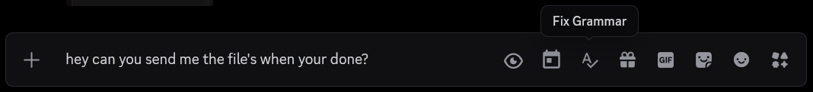
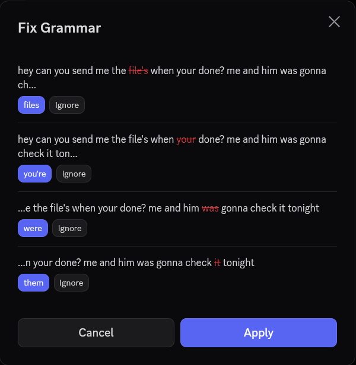
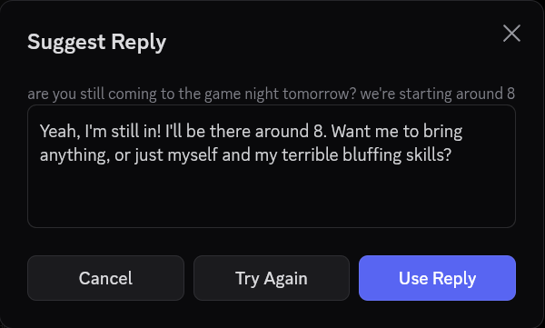
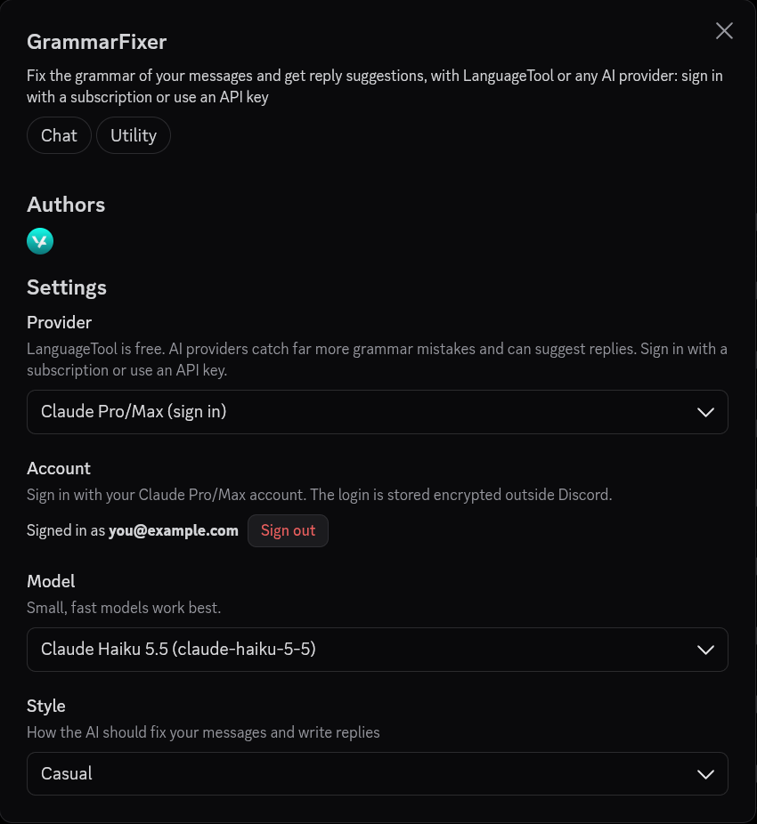

<div align="center">


# Grammar Fixer for Vencord

Fix the grammar of your Discord messages and get reply suggestions.

[](https://vencord.dev)
[](LICENSE)



</div>

## Features

- **Fix Grammar**: click the button in the chat bar to check your message. Every fix is listed on its own, so you can keep or ignore each one.
- **Suggest Reply**: right-click a message to get a reply written for you.
- **Writing styles**: Minimal changes, Casual, Concise or Formal.
- Mentions, emojis, links and code are left alone.

<table>
  <tr>
    <td width="50%"></td>
    <td width="50%"></td>
  </tr>
</table>

## Providers



- **LanguageTool**: free, no account needed.
- **Any API key provider**: 220+ from [models.dev](https://models.dev), like OpenAI, Anthropic, Google, DeepSeek and OpenRouter.
- **Custom**: any OpenAI-compatible server, including local ones like Ollama.
- **Subscription sign in**: Claude, ChatGPT, GitHub Copilot, Gemini and more.

Keys and sign ins are stored encrypted outside Discord. Text is only sent when you click a button.

<br clear="right">

## Install

Needs a [source build of Vencord](https://docs.vencord.dev/installing/). From your Vencord folder:

```bash
git clone https://github.com/ve3dy/vencord-grammar-fixer.git src/userplugins/grammarFixer
pnpm build
```

Then fully quit Discord (Ctrl+R isn't enough), open it again, and enable **GrammarFixer** in Vencord's plugin settings.

To update, run `git pull` in `src/userplugins/grammarFixer`, then `pnpm build` and restart Discord.

Prefer a script? From a clone of this repo, run `./install.sh /path/to/Vencord` on macOS or Linux, or `.\install.ps1 -VencordPath C:\path\to\Vencord` on Windows.

## License

[GPL-3.0-or-later](LICENSE). Not affiliated with Vencord or Discord.

Sign in flows are ported from [oh-my-pi](https://github.com/can1357/oh-my-pi), the provider list comes from [models.dev](https://models.dev), and free checks are by [LanguageTool](https://languagetool.org).
